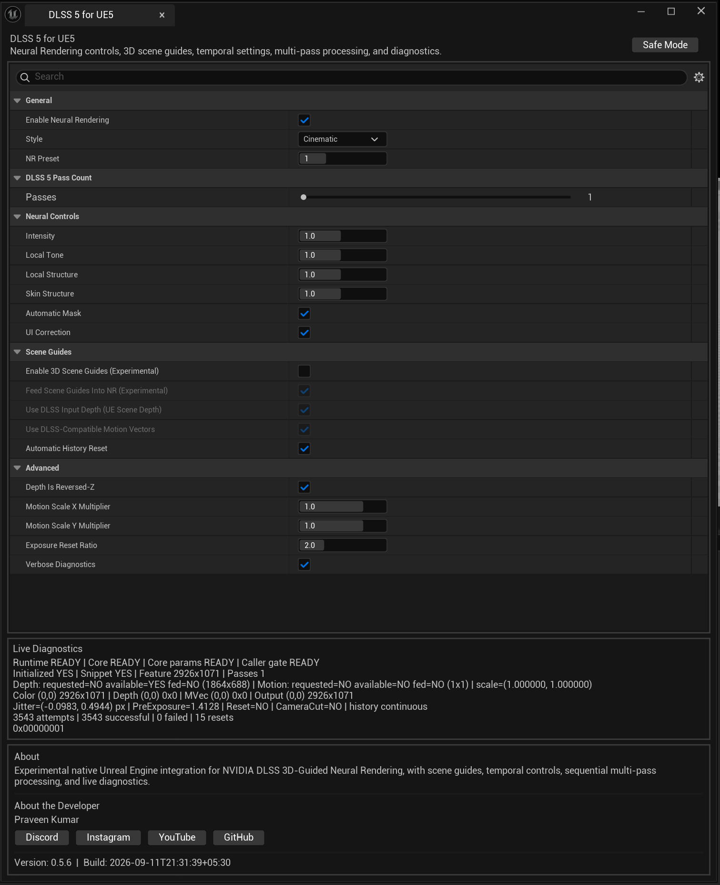
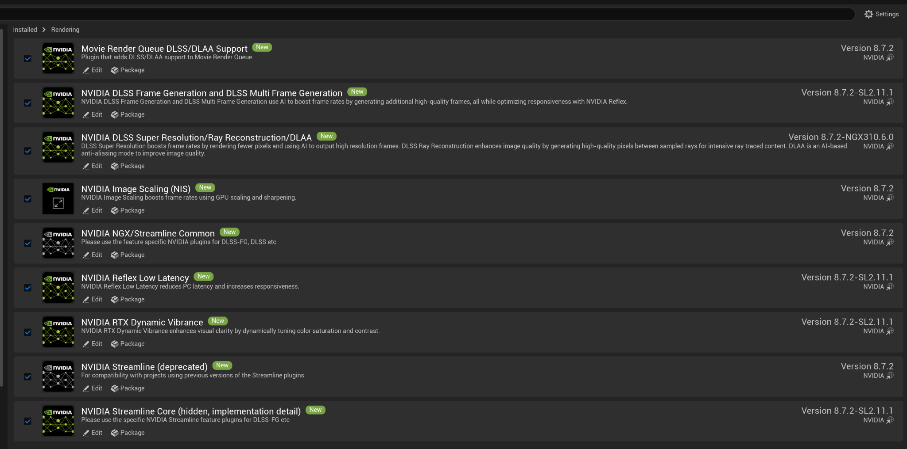
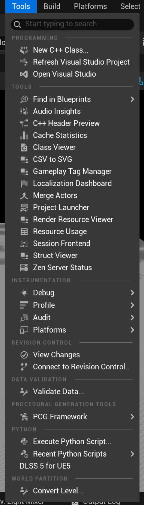
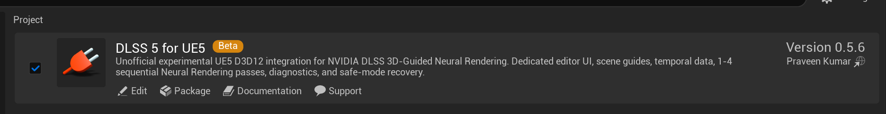
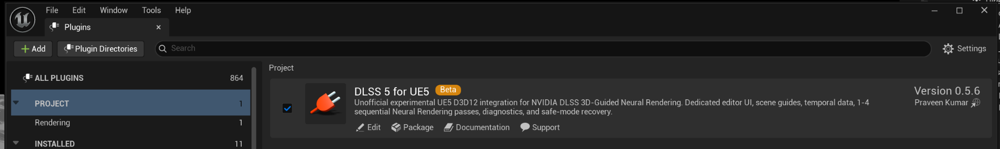

# DLSS5ForUE5

**Experimental DLSS 5 Neural Rendering integration for Unreal Engine 5.5–5.8**

DLSS5ForUE5 is an unofficial Unreal Engine plugin that integrates NVIDIA NGX Neural Rendering into the UE editor on D3D12. It provides artist-facing controls, UE scene guides, temporal data, live diagnostics, Safe Mode, and optional 1–4 sequential Neural Rendering passes.

> **Unofficial community project.** DLSS5ForUE5 is not affiliated with, sponsored by, or endorsed by NVIDIA Corporation or Epic Games, Inc.



## Download

Download the precompiled plugin from the [Releases page](https://github.com/praveenkumarappu/DLSS5ForUE5/releases) and use the ZIP matching your Unreal Engine version:

- `DLSS5ForUE5.v0.6.0.-UE5.5.zip`
- `DLSS5ForUE5.v0.6.0.-UE5.6.zip`
- `DLSS5ForUE5.v0.6.0.-UE5.7.zip`
- `DLSS5ForUE5.v0.6.0.-UE5.8.zip`

The GitHub repository contains the universal source code. Normal users do **not** need to compile the plugin when using the matching release ZIP.

## Requirements

- Windows 10 or Windows 11, 64-bit
- Unreal Engine **5.5, 5.6, 5.7, or 5.8**
- DirectX 12
- Shader Model 6 recommended
- Compatible NVIDIA RTX GPU and current NVIDIA driver
- NVIDIA's official **DLSS Unreal Engine plugin** installed and enabled
- The DLSS5ForUE5 release ZIP matching your Unreal Engine version

DLSS5ForUE5 relies on NVIDIA's official UE DLSS/NGX integration for NGX initialization. The NVIDIA DLSS plugin is therefore a required dependency.



## Installation

1. Install NVIDIA's official DLSS plugin for the same Unreal Engine version as your project.
2. Download the matching DLSS5ForUE5 release ZIP.
3. Extract the `DLSS5ForUE5` folder into:

```text
YourProject/
└── Plugins/
    └── DLSS5ForUE5/
```

4. Open the project and enable **DLSS** and **DLSS 5 for UE5** if Unreal asks.
5. Restart the editor.
6. Open:

```text
Tools → DLSS 5 for UE5
```



The precompiled release already contains the plugin binaries for that UE version, so Visual Studio is not required for normal installation.

## Screenshots

**Plugin card**



**Plugin Browser**



## Engine compatibility and validation scope

The maintained stable baseline is **v0.6.0**. Neural Rendering remains experimental and editor-focused; "stable" does not mean that every engine, GPU, driver, or packaged configuration has been independently validated.

| Unreal Engine | v0.6.0 runtime validation |
| --- | --- |
| UE 5.5 | Maintainer-tested editor NR lifetime update with 3D scene guides |
| UE 5.6 | Maintainer-tested editor NR lifetime update with 3D scene guides |
| UE 5.7 | Compatibility target; equivalent v0.6.0 runtime checks pending |
| UE 5.8 | Compatibility target; equivalent v0.6.0 runtime checks pending |

These are existing maintainer validation claims, not new tests performed by this documentation update. See [runtime validation](docs/NR_RUNTIME_VALIDATION.md) for the test scope.

**Packaged Development and Shipping native Neural Rendering are unsupported for this baseline.** A separate v0.6.1 validation build failed NGX initialization with `NVSDK_NGX_D3D12_Init_Ext` returning `0xBAD00002` and zero successful native evaluations. Those results are not direct v0.6.0 validation, and successful packaging or fallback rendering does not establish native inference support.

## Features

- Dedicated **Tools → DLSS 5 for UE5** window
- Natural and Cinematic styles
- Neural Rendering preset control
- Intensity, Local Tone, Local Structure, and Skin Structure controls
- Automatic Mask and UI Correction controls
- UE Scene Depth guide
- Dense DLSS-compatible motion-vector guide
- Jitter, pre-exposure, camera-cut, and history-reset tracking
- Automatic history reset
- **1–4 sequential Neural Rendering passes**
- Live diagnostics for runtime, NGX, guides, subrects, temporal state, and frame counters
- Safe Mode recovery
- Console commands under `DLSS5.*` / `r.DLSS5.*`

## DLSS 5 Pass Count

Pass Count can run Neural Rendering from **1 to 4 times sequentially**. Each pass consumes the previous pass output rather than repeatedly processing the untouched source image.

More passes significantly increase GPU cost and are not automatically better. Start with **1 pass** and increase only when the stronger cumulative result is desired.

## Scene Guides

The plugin can feed UE scene depth and generated dense motion vectors into Neural Rendering. Scene guides were found to improve temporal stability and reduce visible flicker in tested scenes.

Motion-vector handling remains experimental because some UE render-hook states expose the native object-velocity source as a `1×1` dummy texture. The plugin reconstructs camera/background motion from depth when necessary.

## Diagnostics

Useful console commands:

```text
DLSS5.Open
DLSS5.Status
DLSS5.SafeMode
```

Common CVars include:

```text
r.DLSS5.Enable
r.DLSS5.PassCount
r.DLSS5.Intensity
r.DLSS5.EnableSceneGuides
r.DLSS5.FeedSceneGuides
r.DLSS5.UseDepth
r.DLSS5.UseMotionVectors
```

See [docs/COMMANDS.md](docs/COMMANDS.md) for the full list.

## Known issue: Movie Render Queue / Streamline

Certain NVIDIA Streamline plugin builds can assert when Movie Render Queue starts a PIE-style render session. The observed crash originates inside NVIDIA's `StreamlineRHI::OnBeginPIE()` rather than DLSS5ForUE5.

See [docs/KNOWN_ISSUES.md](docs/KNOWN_ISSUES.md) for details and workarounds.

## Source builds

The repository uses one version-aware source tree for UE 5.5–5.8. Compatibility code is selected at compile time with Unreal Engine version guards. UE 5.5 requires legacy `ISceneViewExtension` overrides, while UE 5.8 uses the newer `FCoreDelegates::GetOnPostEngineInit()` API.

## Developer

**Praveen Kumar**

- Discord: https://discord.com/invite/UFsuT4w
- YouTube: https://www.youtube.com/@MrPK
- Instagram: https://instagram.com/praveenkumarappu
- GitHub: https://github.com/praveenkumarappu

## Contributors

- **[@scragnog](https://github.com/scragnog)** — identified and fixed the NR GPU feature-lifetime and temporal-history isolation issue in [#1](https://github.com/praveenkumarappu/DLSS5ForUE5/issues/1) / [#2](https://github.com/praveenkumarappu/DLSS5ForUE5/pull/2), including per-view/pass histories, GPU-fence retirement, guide/history fixes, motion-vector corrections, and regression coverage.

## Documentation

- [Installation](docs/INSTALLATION.md)
- [Usage](docs/USAGE.md)
- [Commands & CVars](docs/COMMANDS.md)
- [Known Issues](docs/KNOWN_ISSUES.md)
- [Troubleshooting](docs/TROUBLESHOOTING.md)
- [Architecture](docs/ARCHITECTURE.md)
- [Release Notes](RELEASE_NOTES_v0.6.0.md)
- [SHA-256 Checksums](SHA256SUMS_v0.6.0.txt)
- [Contributing](CONTRIBUTING.md)
- [Security](SECURITY.md)
- [Third-Party Notices](THIRD_PARTY_NOTICES.md)

## Third-party software

The release packages include NVIDIA runtime components used by the plugin. NVIDIA software is **not** licensed under this repository's MIT License and remains subject to NVIDIA's applicable license terms. See [THIRD_PARTY_NOTICES.md](THIRD_PARTY_NOTICES.md).

## License

The original DLSS5ForUE5 source code in this repository is released under the **MIT License**. NVIDIA software, Unreal Engine, and other third-party components remain governed by their respective licenses.